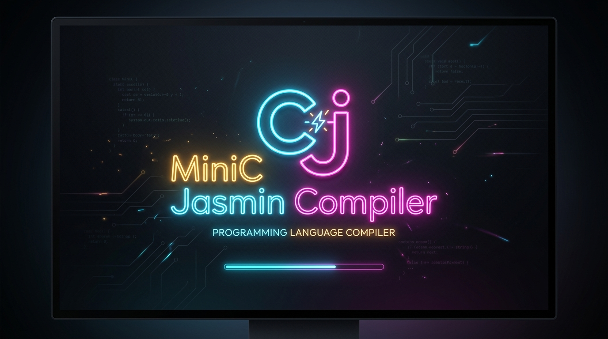

# MiniC → Jasmin Compiler

A small, single-file compiler that translates **MiniC**, a tiny C-like language, into [Jasmin](https://jasmin.sourceforge.net/) assembly for the Java Virtual Machine. It is written in plain Java with no dependencies, and is meant as a readable example of a complete compiler pipeline: lexer, recursive-descent parser, AST and code generator.

> **License notice:** this project is released under the **MIT License**. Use, copying, modification and distribution are governed by its terms. See [License](#license) below and the [`LICENSE`](LICENSE) file.

## Features

- Lexer, recursive-descent parser, AST and code generator in one Java file
- Precise error messages with line and column numbers
- Correct JVM bytecode for nested `if`, `while` and `for` statements
- Computes `.limit locals` and `.limit stack` for you
- Optional `--dump` flag so the compiled program prints its variables on exit

## Requirements

- Java 17 or later (the source uses records and sealed interfaces)
- A Jasmin assembler, to turn the output into a `.class` file

## Quick start

```bash
# Compile the compiler
javac MiniCJasminCompiler.java

# Compile the built-in sample program to Jasmin assembly
java MiniCJasminCompiler > Main.j

# Assemble and run (assumes jasmin.jar is available)
java -jar jasmin.jar Main.j
java Main
```

The compiler always emits a class named `Main`, so the assembled output is `Main.class`.

### Command line

```
java MiniCJasminCompiler [--dump] [file | -]
```

| Argument | Meaning |
|----------|---------|
| `file`   | Compile the MiniC source in `file` |
| `-`      | Read MiniC source from standard input |
| *(none)* | Compile the built-in sample program |
| `--dump` | Make the generated program print every variable when it finishes |

Jasmin assembly is written to standard output. Compile errors are written to standard error and the process exits with status 1.

## The MiniC language

All variables are 32-bit integers. They are declared implicitly by their first use, and each is initialised to `0` when the program starts. The language has no input, output, functions, `else`, subtraction or parentheses, so use `--dump` to see results.

```c
x = 0;
for (i = 0; i < 3; i = i + 1) {
    x = x + i;
}
```

### Grammar (BNF)

```bnf
<program>     ::= <statements>

<statements>  ::= <statement> <statements>
                | ""

<statement>   ::= <assignment>
                | <if-stmt>
                | <while-stmt>
                | <for-stmt>

<block>       ::= "{" <statements> "}"

<assignment>  ::= <ident> "=" <expr> ";"

<if-stmt>     ::= "if" "(" <cond> ")" <block>

<while-stmt>  ::= "while" "(" <cond> ")" <block>

<for-stmt>    ::= "for" "(" <assignment> <cond> ";" <update> ")" <block>

<update>      ::= <ident> "=" <expr>

<cond>        ::= <term> <relop> <term>

<relop>       ::= "<" | "=="

<expr>        ::= <expr> "+" <term>
                | <term>

<term>        ::= <number>
                | <ident>

<ident>       ::= <letter>
                | <ident> <letter>
                | <ident> <digit>

<number>      ::= <digit>
                | <number> <digit>

<letter>      ::= "a" | ... | "z" | "A" | ... | "Z"
<digit>       ::= "0" | ... | "9"
```

Notes on the grammar:

- `if`, `while` and `for` are reserved words and can't be used as variable names.
- Conditions compare two *terms* (a number or a variable), not full expressions, so `i < n + 1` is not valid.
- The `for` initialiser is a complete assignment and includes its own `;`. The condition is followed by an explicit `;`, and the update has no trailing `;`.
- `+` is left-associative.
- Integer literals must fit in a 32-bit signed `int`.
- Whitespace separates tokens and is otherwise ignored. There are no comments.

## Example output

For the sample program above, the compiler emits Jasmin assembly like this:

```jasmin
.class public Main
.super java/lang/Object

.method public static main([Ljava/lang/String;)V
    .limit stack 2
    .limit locals 3

    iconst_0
    istore 1
    iconst_0
    istore 2

    iconst_0
    istore 1
    iconst_0
    istore 2
L0_for:
    iload 2
    iconst_3
    if_icmpge L1_endfor
    iload 1
    iload 2
    iadd
    istore 1
    iload 2
    iconst_1
    iadd
    istore 2
    goto L0_for
L1_endfor:

    return
.end method
```

The first four instructions initialise the two variables (`x` in slot 1, `i` in slot 2) to zero. Local slot 0 is reserved for the `String[] args` parameter.

## Error messages

Errors report the position of the offending token:

```
$ echo 'x = ;' | java MiniCJasminCompiler -
Compile error: line 1, column 5: expected number or identifier but found ';'
```

Other conditions that are reported include unexpected characters, missing `}` at end of input, unsupported comparison operators and integer literals that are too large.

## How it works

| Stage | Description |
|-------|-------------|
| **Lexer** | Splits the source into tokens and tracks line and column. Keywords are recognised on whole words, so `format` is an identifier, not `for`. |
| **Parser** | One method per grammar rule. It builds an AST and records the variables in order of first appearance. |
| **Code generator** | Assigns each variable a local slot starting at 1, emits zero-initialisation, then generates code for each statement. |

Control flow is compiled as follows:

- **`if`** evaluates the condition and jumps past the body when it is false.
- **`while`** places a label at the top, tests the condition, runs the body and jumps back.
- **`for`** runs the initialiser once, then loops: test, body, update, jump back.
- **`<`** compiles to `if_icmpge` and **`==`** to `if_icmpne`, each branching on the negated condition.

Labels are numbered, so nested loops never collide.

## Limitations

- Only `int` variables, `+`, `<` and `==`
- No `else`, no other arithmetic or comparison operators, no parentheses
- No functions, input or output
- The output class is always named `Main`

## Contributing

Issues and pull requests are welcome. By submitting a contribution you agree that it will be licensed under the same MIT License as the rest of the project.

## Further Reading

[Let's build a compiler for the JVM: in six parts]([https://medium.com/@mariogianota/lets-build-a-compiler-for-the-jvm-a-six-part-series-902b3e908672])

## License

This project is licensed under the **MIT License**. You may use, copy, modify, merge, publish, distribute, sublicense and sell copies of the software, provided that the copyright notice and this permission notice are included in all copies or substantial portions of the software.

```
MIT License

Copyright (c) 2026 Mario Gianota 

Permission is hereby granted, free of charge, to any person obtaining a copy
of this software and associated documentation files (the "Software"), to deal
in the Software without restriction, including without limitation the rights
to use, copy, modify, merge, publish, distribute, sublicense, and/or sell
copies of the Software, and to permit persons to whom the Software is
furnished to do so, subject to the following conditions:

The above copyright notice and this permission notice shall be included in all
copies or substantial portions of the Software.

THE SOFTWARE IS PROVIDED "AS IS", WITHOUT WARRANTY OF ANY KIND, EXPRESS OR
IMPLIED, INCLUDING BUT NOT LIMITED TO THE WARRANTIES OF MERCHANTABILITY,
FITNESS FOR A PARTICULAR PURPOSE AND NONINFRINGEMENT. IN NO EVENT SHALL THE
AUTHORS OR COPYRIGHT HOLDERS BE LIABLE FOR ANY CLAIM, DAMAGES OR OTHER
LIABILITY, WHETHER IN AN ACTION OF CONTRACT, TORT OR OTHERWISE, ARISING FROM,
OUT OF OR IN CONNECTION WITH THE SOFTWARE OR THE USE OR OTHER DEALINGS IN THE
SOFTWARE.
```
